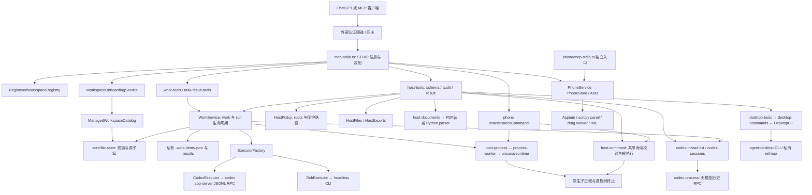

# Workbench 公共接口架构审计

后续实施：已加入[显式 v1/v2 名称配置](api-name-profiles.md)，默认 v1，v2 替换十一项名称且不同时注册旧别名。下表继续作为 v1 固定清单，v2 按迁移表逐项映射，字段及工具总数相同；先前关于命名的建议已落实为注册代码，其余响应格式、选择器和跨实例租约建议仍待实施。

本次审计覆盖整个公共 MCP 接口，不限于进程工具。初始基线为 `7ce2c53`，已整合当前 main `1183433` 的统一文件读取变更，新增只读 `list_tasks` 后的接口如下；生产入口为 `src/mcp-stdio.ts`，独立手机入口为 `src/phone/mcp-stdio.ts`。源码、测试及可选适配器已交叉检查，当前部署实例未重启，客户端缓存和真实硬件可用性不属于本次源码验证结果。

## 方法、计数与发现边界

`tests/unit/api-inventory.test.ts` 用 TypeScript AST 遍历全部 `src/**/*.ts` 的工具、资源及 prompt 注册调用，再与实际 STDIO `tools/list` 比对；动态名称来自 `desktopSchemas` 和 `phoneSchemas`，没有只扫描字面量。测试锁定注册模块，新增注册入口会要求人工补充清单。完整 JSON inputSchema 的 SHA-256 固定在 `tests/fixtures/api-schema-digests.json`，防止无意修改名称或签名；本文每个工具的输入字段与实际 schema 自动核对。

两个名称配置共 128 组真实子进程组合覆盖 host × commands × exports × phone × desktop，其中桌面为关闭、只观察、全部启用、主机名不匹配四种状态。另测两种名称配置的独立手机入口、24 组细分桌面权限和功能恢复。依赖路径使用测试替身，只发现工具，不连接真实手机或桌面。完整 schema、目录字节量及每组计数保存在运行测试的工作树 `codex-generated/api-audit/`。文档、README 中的当前计数也有断言；RELEASE_NOTES 中的 24-tool 数字属于历史版本记录，保留其当时含义。

<!-- api-counts: {"disabled":15,"host":26,"exports":29,"phone":11,"desktop_max":11,"all":51} -->

| 配置 | 工具数 | 规则 |
| --- | ---: | --- |
| host 关闭，无手机 | 15 | 工作 7 + 项目 3 + 任务 4 + host_capabilities 1 |
| host 开启，无 export/phone/desktop | 26 | 增加 11；commands_enabled=false 仍注册命令工具，执行时拒绝 |
| 再配置 export_roots | 29 | 增加 3 及一个 resource template |
| phone 开启 | +11 | 与 host 开关独立；含未带前缀的 server_status 及旧文档漏列的 phone_drag |
| desktop 只观察 | +6 | status/list/snapshot/find/read/wait；仍要求 host、desktop 及 hostname 匹配 |
| desktop 全部权限 | +11 | 可再增加 act/window/clipboard/screenshot/input |
| 所有模块 | 51 | 没有全局固定的“26 个工具”承诺 |
| 独立 phone STDIO | 11 | 相同 phoneSchemas、服务及指令，不含 host_capabilities 或通用任务 |

没有独立 document-enabled 开关：host 关闭则解析入口消失，host 开启即注册；Python 缺失会在调用时报告，PDF.js 随包提供。OpenCLI、MinerU、Git、Appium、scrcpy、ADB 是调用依赖或本机 CLI，不是额外 MCP 注册工具。没有 prompt 注册；唯一资源模板为 `host-export` / `bridge-export://{export_id}`，仅授权 export 时存在，`resources/list` 不枚举缓冲数据。

工具名称及 schema 不随 Windows/Linux/macOS 变化，实际执行限制随平台变化：Windows 的文档解释器为 `py -3`，其他平台为 `python3`；Windows 桌面 type/right-click 等要求 headed/physical 权限；原生进程使用 Windows taskkill 或 POSIX 进程组。工具被发现只证明注册成功，不能证明二进制、辅助权限或硬件正常。本机测试不能替代 Linux/macOS 运行验收，跨平台 CI 应继续运行此矩阵。

## 全量工具清单

“同步”表示本次 MCP 请求等待返回，内部仍可使用异步 I/O；只有返回 task_id 的执行进入通用任务生命周期。表中的策略是服务端约束，MCP annotations 只是客户端提示。本轮默认保留签名，唯一新名称 list_tasks 解决此前缺失的查询能力。并行文档任务在 1183433 已将 read_host_document 合并进 read_host_file；本轮按最新 main 审计，不重新添加该名称。

### 身份、工作与任务

| 工具 | 域 | 输入字段，机器核对 | 标识与作用域 | 访问 / 策略 | 调用方式 | 状态及命名取舍 |
| --- | --- | --- | --- | --- | --- | --- |
| `list_work` | 工作 | archived, cwd, limit, offset, query, status, workspace_id | work_id | 只读注册表 | 同步 | 保留；仅持久工作，不是全部任务 |
| `open_work` | 工作 | access, cwd, name, thread_id, work_id, workspace_id | work_id / thread_id / workspace_id | 登记及原生 unarchive；cwd 读策略 | 同步 RPC | 保留；prepare/reopen/adopt，不运行模型 |
| `continue_work` | 工作 | access, instruction, model, reasoning_effort, work_id | work_id → task_id / thread_id | 每次执行 access；继承工作设置 | 异步任务 | 保留；持久 Codex turn |
| `run_temp` | agent | access, cwd, executor, instruction, model, reasoning_effort, work_id, workspace_id | task_id；可关联 work_id | access 默认完全访问；cwd 读策略 | 异步任务 | v1 保留；v2 run_agent_once；临时会话，结果仍保留 |
| `finish_work` | 工作 | references, summary, work_id | work_id | 修改完成状态及总结 | 同步 | 保留；用户目标的语义完成，不是终止进程 |
| `manage_work` | 工作 | action, work_id | work_id / thread_id | 可删除原生历史及子线程 | 同步 RPC | 保留 action 分组；不扩成四个别名 |
| `work_retention` | 维护 | archive_completed_days, delete_archived_days, max_results, result_days, sweep | 工作及任务结果 | 读配置或修改/清理 | 同步 RPC | 保留兼容；名称范围偏窄，策略也覆盖 process |
| `list_workspaces` | 项目 | query | workspace_id | 只读已登记身份 | 同步 | 保留；不扫描磁盘或 Codex 历史 |
| `bind_project` | 项目 | project_path | 路径 → workspace_id | project_root 内登记目录 | 同步 | 保留；不创建文件，身份登记仍是写操作 |
| `create_project` | 项目 | name, parent | 路径 → workspace_id | project_root 内 mkdir + git init + 登记 | 同步子进程 | 保留；不是从模板创建项目 |
| `list_tasks` | 任务 | created_after, kind, limit, offset, state | task_id | 只读共享 runs 元数据 | 同步 | 新增；补足丢失回执恢复，无相同功能旧接口 |
| `task_result` | 任务 | task_id | task_id | 只读共享结果 | 同步 | v1 保留；v2 get_task，明确也查询运行中状态/输出 |
| `wait_task` | 任务 | task_id, timeout_seconds | task_id | 只读；取消仅结束等待 | 有界等待 | 保留；超时返回当前视图 |
| `control_task` | 任务 | action, instruction, task_id | task_id | 仅持有 live handle 的实例；依执行器能力 | 控制请求 | 保留 interrupt/steer；interrupt 回执不证明已退出 |
| `host_capabilities` | 能力 | — | server_version；version 是策略格式 | 只读本实例加载的策略 | 同步 | 保留；暴露不等于授权，更不等于依赖可用 |
| `reload_workspace_config` | 维护 | — | 当前配置文件 | host 开启且无待执行任务 | 同步 | 保留；只重载 workspace，不重载 host/phone/identity |

### 主机文件、历史及进程

| 工具 | 域 | 输入字段，机器核对 | 标识与作用域 | 访问 / 策略 | 调用方式 | 状态及命名取舍 |
| --- | --- | --- | --- | --- | --- | --- |
| `list_codex_projects` | 历史 | archived, codex_home, cursor, query, scan_limit | cwd / codex_home / cursor | host 开启；配置历史根及目录检查 | 同步 RPC | 保留；按 cwd 分组当前页历史，不是 workspace 注册表 |
| `list_codex_threads` | 历史 | archived, codex_home, cursor, cwd, limit, query | thread_id / cwd / codex_home | 同历史策略 | 同步 RPC | 保留；元数据而非完整对话；未验证其他客户端活跃情况 |
| `read_host_file` | 文件 | encoding, include_sha256, max_bytes, max_chars, mode, offset, path | 绝对 path；byte / character offset | read_roots；保护路径及链接检查 | 同步 I/O | 保留；auto 解析文档，raw 保留字节；必须检查 offset_unit |
| `list_host_path` | 文件 | limit, offset, path | 绝对 path；offset | read_roots | 同步 I/O | 保留；单层目录枚举，不是递归搜索 |
| `write_host_text_file` | 文件 | content, create_parents, expected_sha256, path | path / expected_sha256 | write_roots；替换需当前摘要 | 同步 I/O | 保留；新增拒绝覆盖；配置另需 reload |
| `copy_file` | 文件 | create_parents, destination, source | source / destination | 源 read、目的 write | 同步 I/O | 保留旧短名；不增加 host_copy_file |
| `move_file` | 文件 | create_parents, destination, expected_sha256, source | source / destination / expected_sha256 | 源 read/write、目的 write；摘要检查 | 同步 I/O | 保留；复制验证后删除，不是目录搬移 |
| `delete_file` | 文件 | expected_sha256, path | path / expected_sha256 | write；文件摘要；空目录例外 | 同步 I/O | 保留；无递归删除 |
| `run_host_command` | 命令 | args, cwd, executable, timeout_seconds | executable / cwd | host + commands_enabled + command_roots | 同步 ≤45s | 保留；argv 无隐式 shell；OS 账户权限 |
| `start_host_process` | 进程 | args, cwd, executable, timeout_seconds | executable / cwd → task_id | 与同步命令共享校验；手机维护互斥 | 异步任务 | 保留；无需 agent；不支持持久会话或 stdin |
| `export_host_file` | 交付 | path | path → export_id | export_roots；内存快照及配额 | 同步 I/O | 保留；交付与读取不同，resource_link 非下载 URL |
| `read_export_chunk` | 交付 | content_text, export_id, max_bytes, offset | export_id / byte offset | 同实例有效 export_id | 同步 | 保留；Base64，摘要验证，可重读同 offset |
| `release_host_export` | 交付 | export_id | export_id | 释放本实例缓存 | 同步 | 保留；不删除源文件 |

### 可选手机

| 工具 | 域 | 输入字段，机器核对 | 标识与作用域 | 访问 / 策略 | 调用方式 | 状态及命名取舍 |
| --- | --- | --- | --- | --- | --- | --- |
| `server_status` | 手机 | — | 设备配置；无 task_id | phone 配置；只读设备探测 | 同步 ADB | v1 保留；v2 phone_status；每套目录只注册一个名称 |
| `phone_acquire_control` | 手机 | — | → lease_id | 独占短期 bearer lease；可能切换 IME | 同步 ADB | 保留；不是只读能力查询 |
| `phone_release_control` | 手机 | lease_id | lease_id | 有效 bearer lease | 同步 | 保留；幂等释放，不代表任务完成 |
| `phone_observe` | 手机 | image, response_detail, ui, wait_for | → frame_id / element_id | 只读设备；不要求控制 lease | 同步观察/等待 | 保留；frame 有效期短，内容是不可信数据 |
| `phone_list_apps` | 手机 | limit, offset, refresh, search | package / offset | 只读设备及缓存 | 同步 ADB | 保留；刷新只更新缓存 |
| `phone_open_app` | 手机 | lease_id, observation, package, request_id, response_detail, wait_for | lease_id / request_id / package | lease + 持久请求回执 | 同步设备操作 | 保留；验证观察结果，不推定业务成功 |
| `phone_input` | 手机 | action, frame_id, lease_id, observation, request_id, response_detail, wait_for | lease_id / request_id / frame_id | lease + 新鲜观察 + action 校验 | 同步设备操作 | 保留分组 action；不增加 tap/type 别名 |
| `phone_drag` | 手机 | drag_id, duration_ms, frame_id, lease_id, observation, phase, request_id, response_detail, x, y | lease_id / request_id / frame_id / drag_id | lease；连接内连续触摸；scrcpy | 跨调用交互 | 保留；start/move/end/cancel，不是通用 task |
| `phone_sequence` | 手机 | frame_id, input_ready_timeout_ms, lease_id, observation, request_id, response_detail, settle_ms, steps | lease_id / request_id / frame_id | lease；1–8 steps；回执去重 | 同步有限序列 | 保留；超时停后续步骤，非后台任务 |
| `phone_display` | 手机 | action, lease_id, observation, request_id, response_detail | lease_id / request_id | lease；physical_off 另需 scrcpy | 同步设备操作 | 保留；能力不足返回未支持/未验证 |
| `phone_recover` | 手机 | action, lease_id, observation, request_id, response_detail | lease_id / request_id | lease；有限 check/wake | 同步设备操作 | 保留；reconnect 只返回 needs_user_action，不重启共享 ADB |

### 可选桌面

| 工具 | 域 | 输入字段，机器核对 | 标识与作用域 | 访问 / 策略 | 调用方式 | 状态及命名取舍 |
| --- | --- | --- | --- | --- | --- | --- |
| `desktop_status` | 桌面 | request | 无 | host + desktop + hostname；逐命令再校验 | 同步 CLI ≤43s | 保留 request 分组；观察 |
| `desktop_list` | 桌面 | request | app / window_id | host + desktop + hostname；逐命令再校验 | 同步 CLI ≤43s | 保留 request 分组；观察 |
| `desktop_snapshot` | 桌面 | request | namespace / app / window_id / ref | host + desktop + hostname；逐命令再校验 | 同步 CLI ≤43s | 保留 request 分组；观察 |
| `desktop_find` | 桌面 | request | namespace / app / window_id / ref | host + desktop + hostname；逐命令再校验 | 同步 CLI ≤43s | 保留 request 分组；观察 |
| `desktop_read` | 桌面 | request | namespace / ref | host + desktop + hostname；逐命令再校验 | 同步 CLI ≤43s | 保留 request 分组；观察 |
| `desktop_act` | 桌面 | request | namespace / ref | host + desktop + hostname；逐命令再校验；allow_mutations | 同步 CLI ≤43s | 保留 request 分组；修改后需观察验证 |
| `desktop_window` | 桌面 | request | app_key / window_id | host + desktop + hostname；逐命令再校验；allow_mutations | 同步 CLI ≤43s | 保留 request 分组；修改后需观察验证 |
| `desktop_clipboard` | 桌面 | request | 无 | host + desktop + hostname；逐命令再校验；clipboard；写另需 mutations | 同步 CLI ≤43s | 保留 request 分组；修改后需观察验证 |
| `desktop_screenshot` | 桌面 | request | window_id | host + desktop + hostname；逐命令再校验；allow_screenshot | 同步 CLI ≤43s | 保留 request 分组；观察 |
| `desktop_wait` | 桌面 | request | namespace / ref / app | host + desktop + hostname；逐命令再校验 | 同步 CLI ≤43s | 保留 request 分组；观察 |
| `desktop_input` | 桌面 | request | namespace / ref / window_id / coordinates | host + desktop + hostname；逐命令再校验；mutations + headed + physical_input | 同步 CLI ≤43s | 保留 request 分组；修改后需观察验证 |

## 术语、标识与状态不变量

| 术语 | 准确定义及约束 |
| --- | --- |
| project / workspace | project 是用户项目语义；workspace 是登记身份和目录，workspace_id 为不透明字符串，不保证 UUID。project_root 是登记范围，与执行权限分离。 |
| work | 持久 Codex 工作记录，work_id 为 UUID；status=active/completed 是调用方语义判断，archived 单独表示历史可见性。DSH 和普通 process 没有伪造的 work/thread。 |
| thread | Codex 原生历史 UUID，归属于 codex_home；删除历史后 work_id 保留，新 turn 可产生新 thread_id。历史列表的 cwd 不等于已登记 workspace。 |
| task / run | 同一次执行的公共与内部称呼。公共只用 task_id；内部 runs 存储，kind=agent/process。旧记录缺 kind 按 agent 读取。queued/running/completed/failed 与 work.status 分离。 |
| process | 一次 OS 程序执行；executable、cwd、退出状态和输出属于独立 process 字段。没有 model、access 或 thread_id；运行权限来自账户和 host policy。 |
| export / phone / desktop | export_id 是进程内缓存句柄；lease_id 是手机 bearer 权限，request_id 是去重键，frame_id 是短期观察，drag_id 是连接内手指动作；桌面 namespace/ref 是 CLI 观察引用。均不当作 task_id。 |

`list_tasks` 默认按 created_at 倒序，时间相同按 task_id 排序；created_after 为含端点的 UTC ISO 时间，offset/limit 最多 100 条。只读取当前 store 保留的任务元数据，不返回结果内容、argv、instruction、stderr、stdout 或 owner_pid。路径本身仍可能含私人信息，应按可信个人服务处理。分页不是事务快照，并发开始或清理时可出现页面位移；需要按 task_id 去重。已清理结果、另一配置的 store、未成功保存的启动无法通过此入口恢复。存在多个相似候选时继续检查证据，不自动猜选或重发命令。

`control_available` 只表示本实例持有活动 handle，终态恒为 false。其他实例共享 store 可以查询状态，不能凭磁盘 PID 获取控制权；同一 agent 的 steer/interrupt 支持程度仍由执行器决定。任务控制未引入远程转发或杀死任意 PID 的权限。ready=true 只表示记录终态；process.outcome_unknown、error 及实际文件需分别检查，interrupt 返回不是退出证明。wait_task 超时或取消不会取消执行，start 响应在调度后丢失也不会取消执行。

## 模块依赖与数据 / 控制边界

配置加载位于入口：workspace 手工配置、managed catalog、identity、host policy、phone 配置各自负责不同含义。reload_workspace_config 只替换身份注册表及 onboarding，已有 task 存在时拒绝；host policy/phone/identity 需协调重启。phone/admin.ts 的 pause/resume/recover-lock 及 scripts 下部署命令是本地维护 CLI，不是远程 MCP 工具，也不是后台隐式更新服务。

身份边界：workspace 选择 cwd，不授予文件写入或网络权限；project_root 约束 bind/create。执行边界：Codex/DSH 的 access 原生传入执行器，默认完全访问；HostPolicy roots 约束 Bridge 文件操作及命令起始 cwd，不隔离子进程的 OS 权限。桌面策略独立于 commands_enabled，安装 CLI 不会启用桌面权限；phone lease 只约束 phone API，完全访问 agent 仍有账户权限。

数据边界：原生 Codex 历史由 Codex 管理，Bridge 保存映射、摘要及结果；export 是有界、过期的内存副本，不是持久 artifact store；手机观察和请求回执存私有 state_dir，桌面 refmap 在单独 state_directory。文件内容、UI 文本和历史预览都作为数据返回，不提升为执行指令。STDIO 不提供多用户隔离，认证在隧道/网关，不能将“readOnlyHint”视为授权。

控制边界：WorkService 保存 live executor / process supervisor handles，磁盘状态用于恢复观察而非自动重新运行；同步 host 命令与异步 process 共用 validateHostCommand，但终止和输出处理按不同生命周期保留。PhoneStore 的 operation.lock 持续覆盖 generic host process 整个执行，避免中途取得 phone lease 与维护命令并发；长进程也会阻塞其他手机操作，属于已知可用性代价。DesktopCli 的 busy 仅限本实例，namespace 隔离引用并不形成跨实例桌面控制租约。

## 问题、优先级与兼容决策

P1 表示会造成错误路由、恢复失败或误判控制结果；P2 表示维护和可用性改进；P3 表示命名风格。本轮不引入破坏式迁移。

| 项目 / 严重度 | 证据与影响 | 本次处理或目标 | 兼容 / 优先级 |
| --- | --- | --- | --- |
| 丢失启动回执 / 高 | process 无 work_id；原 list_work 无法发现 task_id | 已加 list_tasks，真实双实例测试丢失回执、控制归属及敏感字段投影 | 新能力，无别名；P1 已做 |
| 最终审计失败改变回执 / 高 | host safe 曾把正常结果包装为 result，隐藏 task_id | 保留原 body，_meta.audit_warning 报告最终审计失败；初始审计失败仍不派发 | 修复错误路径；P1 已做 |
| live catalog 与 capability 不一致 / 高 | 用户观察旧描述“Desktop GUI control is not provided”；当前源码已说明 opt-in | 分类为部署/客户端元数据漂移，尚未定位具体缓存层；加入实际 desktop.tool_names、运行版本及矩阵 | 不修改运行实例；P1 诊断已做，部署待协调 |
| version 含义 / 中 | host_capabilities.version=1 是策略格式；不能辨别 app 版本 | 添加 server_version=VERSION，保留 version 字段；包版本仍可能跨多个提交相同 | 增量字段；精确部署提交仍需部署记录；P1 已做 |
| run_temp / 高 | 旧 live 文案 any one-off instruction 易把普通命令路由到模型 | 当前源码已写 agent；server instructions 明确命令优先选择及 vocabulary | 名称保留，不加 run_agent；P1 已做 |
| finish_work / 中 | finish 容易理解为终止执行；实际记录 caller decision | 明确不会 stop，不证明业务成功；运行期间拒绝 finish | 不改语义；P1 文档已做 |
| task_result / 中 | 名称像只返回最终结果，实际支持 running snapshot | 保留 current status/output 描述，与 wait/control 区分 | v2 名称配置已实现 get_task，v1 兼容；P2 |
| project/workspace/history / 中 | list_codex_projects 是当前页历史按 cwd 分组，不是登记列表 | 决策指南区分 list_workspaces 与 history discovery；重复项目跨页可重现 | 不合并不同数据源；P1 文档已做 |
| selector 优先级 / 中 | open 的 work/thread/workspace/cwd 与 temp 的 workspace/cwd/work 不同；多选会忽略部分输入 | 当前说明每次只给一个选择器；v2 用显式 tagged target、互斥校验 | 立即拒绝旧组合可能破坏客户端；P2 待迁移 |
| manage_work / 中 | archive、delete_history、forget 删除对象不同；native delete 含子线程 | 保留 action 并逐项解释；destructiveHint 对整个工具保守提示 | 不扩成多个工具；P1 文档已做 |
| work_retention / 中 | 名字似乎只管理 work，实际也清理 process/agent run results | 明确作用范围和立即 prune；v2 可命名 retention，读/配置/清理分域 | 现有签名保留；P2 |
| 手机 server_status / 中 | 无前缀且含版本，易误认 Bridge 健康检查 | 描述明确 Android adapter；独立入口补齐相同安全指令 | v2 phone_status 已实现；默认 v1，无双注册；P2 |
| 手机漏列 / 中 | phoneSchemas 有 11，旧 tools.md 只有 10 | 补 phone_drag，AST + STDIO 自动防漂移 | 文档修正；P1 已做 |
| desktop capability / 中 | 模块启用不保证 mutation/clipboard/物理输入，也不保证 CLI 安装 | 共用 desktopToolNames；clipboard 只能读时 annotation 改为 readOnly | 保留 schema，执行时权限仍复核；P1 已做 |
| 文件短名 / 低 | copy_file/move_file/delete_file 无 host 前缀，与 read_host_file 不一致 | 文档归入 host/files，保留既有短名 | v2 copy_host_file/move_host_file/delete_host_file 已实现；无双注册；P3 |
| 文档与原始字节 / 中 | byte 与 Unicode offset 语义不同，解析与交付也不同 | 1183433 已移除 read_host_document，并将 read_host_file 默认改为 auto；raw/encoding=base64 保留原字节读取。旧文档专用调用和默认 HTML 读取存在迁移影响，需在部署通知中明确 | 该改动来自独立提交，本轮不改其实现；按最新 schema 重验；P1 迁移说明 |
| 工具暴露与授权 / 中 | commands=false 仍列工具，exports/desktop 则隐藏；依赖缺失仍可注册 | 明确 tools/list 是发现，capabilities 是策略，实际调用验证依赖；矩阵覆盖 | 不让关闭命令导致旧名称突然消失；P2 |
| 输出/错误约定 / 中 | host/core error 对象，UNKNOWN_TASK 是字符串，desktop envelope，phone 字符串/receipt；resource 用协议错误 | 保留 v1 各域格式并记录；v2 统一 envelope，保留 disposition/outcome_unknown | 不一次强改已有解析器；P2 |
| schema 与业务校验 / 中 | Zod 形状校验、服务 policy/path 校验职责不同；desktop/phone 二次校验防内部直调越界 | 现有 schema hash + 端到端无效参数测试；不移除必要复核 | v2 才统一 selector、ID、限长标准；P2 |
| MCP mutation hints / 中 | bind/create/control 未明确完整提示；clipboard 有组合条件 | 补明确 annotations；mixed manage/retention 保守标注修改 | 提示不充当授权；P2 已做 |
| 大段描述重复 / 中 | 每个启动工具复制完整恢复策略，wait 又复制长任务指令 | 完整策略仅 server instructions，工具保留短恢复提醒及关键语义 | 不删除已发布工具；减少目录上下文，测试保护提醒；P2 已做 |
| WorkService 耦合 / 中 | work、agent/native process、历史 RPC、存储及保留在一个类 | 复用 task_id 是合理；后续按 TaskRepository / AgentRunner / ProcessRunner 注入，外观兼容 | 当前只加元数据查询，不新建 store/通用框架；P2 |
| 多实例协调 / 高 | 短锁保留写入，不涵盖 read-check-execute；PID 不是唯一实例身份 | 文档标明控制归属与本机 handle；目标 owner nonce + lease/fencing + 幂等启动键 | 需要崩溃恢复/迁移测试，未伪装已解决；P1 后续 |
| 同步锁及资源 / 中 | file-store 使用同步 I/O 和最多 5s 等锁；agent 无共享总量上限；process 限额按实例 | 避免目录返回结果正文；未来异步 repository 与按主机 admission 配额 | 不在命名审计中重写事务模型；P2 |
| 文档解析期限 / 中 | PDF.js 在页面间检查 30s，单个 await 非硬截止；页请求重复解析 | 后续隔离 worker、硬截止及不可变解析缓存；明确当前不是强制抢占保证 | 由 parser 任务独立处理，未修改其文件；P1 后续 |
| phone/desktop 生命周期 / 中 | phone sequence 同步且 request_id 回执；drag 跨调用，desktop refs 私有；通用 task 无法接管 | 保留各域已有生命周期，不把所有交互强行变成 agent task | 后续耗时操作需显式适配，不能只改名字；P2 |
| 其他控制能力 / 中 | 缺少可靠启动幂等键、跨实例控制、stdin/PTY、增量日志 cursor | 优先幂等启动与 owner routing；交互终端需要独立授权和资源设计 | 暂不加通用任意 PID 控制或重复 run 接口；P2 |

### 工具目录成本

按实际 tools/list 的紧凑 JSON UTF-8 字节数测量，不将其直接换算为模型 token；这些值不含传输 envelope。客户端是否加载全部工具、是否缓存目录仍影响实际上下文成本。

| 配置 | 工具数 | 目录字节 | server instructions 字节 |
| --- | ---: | ---: | ---: |
| host 关闭 | 15 | 14,485 | 4,091 |
| host 开启 | 26 | 25,046 | 4,091 |
| host + export | 29 | 27,479 | 4,091 |
| host + export + phone | 40 | 47,945 | 6,812 |
| host + export + 全 desktop | 40 | 48,103 | 5,629 |
| 全模块 | 51 | 68,569 | 8,350 |

手机与桌面各增加约 20 KiB 的 schema/描述，分组 action/request 已减少工具名称数量。兼容调用继续保留，但不重复注册别名；完整恢复指导集中到 server instructions，启动及等待工具只保留短提醒。后续如要按场景缩减目录，应提供显式能力配置及客户端刷新协议，不能静默藏起已依赖的接口。

## 约定与后续协议目标

v1 的成功数据仍主要是 JSON text，file/document/export/desktop 会额外提供 structuredContent；接收端先检查 MCP isError，再按域读取业务状态。输出或 task ready 均不是成功验收。启动操作缺少 request_id 时，不保证网络重试幂等；list_tasks 仅提供恢复候选，不提供 exactly-once 承诺。SDK 参数校验失败与 resource/read 错误是协议层错误，业务失败保留现有格式。文件 copy/move/write 摘要检查与进程 OS 权限是两种边界，不共用一个“安全执行”开关。

后续协议演进建议保留小词汇：workspace 身份、work 持久语义、task 单次执行、thread 原生历史、process 执行种类。通过协商的版本化目录或另一个显式入口迁移，采用分域命名而非在默认目录同时注册旧名与别名。拟议统一响应包含 data、error.code/message、operation state/outcome，desktop disposition 和 phone receipts 原样嵌入；异步启动增加客户端幂等键及稳定 owner 标识，selector 改为互斥 target。迁移前保存 v1 schema 快照、提供客户端切换指南并测试旧 store；不自动重写原生 thread UUID 或删除 legacy 读取器。

初次审计仅新增 list_tasks。后续已实现显式 v2 名称配置，其中 get_task、run_agent_once、phone_status 和 copy_host_file 等替代各自 v1 名称；同一目录仍无重复别名。配置维护继续本地管理，运行时开放任意策略写入接口会改变信任边界，不属于本次改进。

## 验证与部署

初次审计验证记录，后续名称配置测试另见迁移文档及提交记录：本地验证环境为 Windows、Node 24.19.0 / npm 11.17.0。typecheck、build、npm pack --dry-run --ignore-scripts 通过。完整测试集 593 项，591 通过、2 项平台条件跳过、0 失败，最终命令为 node --test --test-concurrency=4 "dist/tests/unit/**/*.test.js"，约 212 秒。常规 npm test 首轮发现指令顺序断言需更新；更新后全量并发触发一次已有 Codex inactivity watchdog 计时失败，该用例独立重跑及限制并发的完整重跑均通过，未改动执行器实现或其测试时限。日志位于本工作树 codex-generated/audit/。矩阵不是硬件验收，未启动真实 agent、ADB 或桌面 CLI。本轮不执行依赖安全公告调查，也不触碰其他工作目录。

部署须在现有工作结束后协调：保留私有配置和 store，构建并更新运行文件，再安排 Bridge 重启；刷新客户端工具元数据，重新读取 host_capabilities.server_version、desktop.tool_names 与 tools/list。server_version 来自包版本，同版本多个提交需要部署记录核对 commit；仅政策 gui_control=true 不证明客户端目录新鲜。不得自动重启活跃实例或远端机器。
